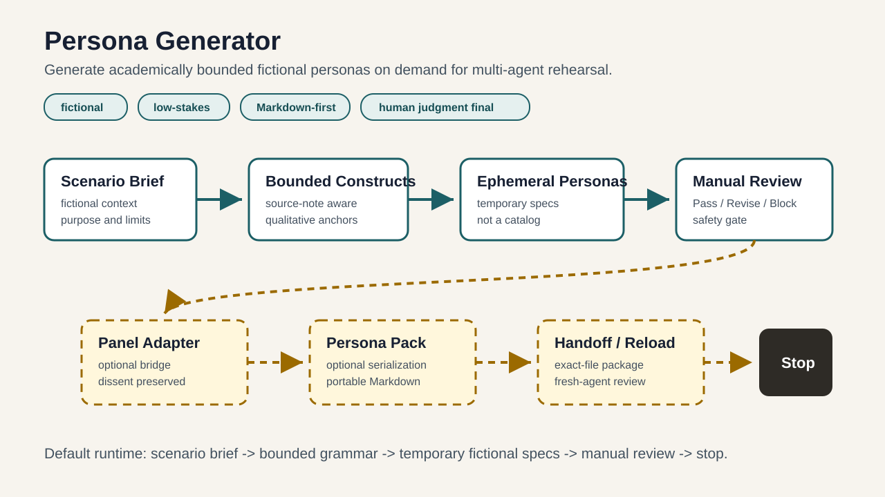

# Persona Generator

Generate academically bounded fictional personas on demand for multi-agent rehearsal.

`Persona Generator stores the grammar for generating personas, not a catalog of predefined personas.`

Persona Generator is a local-first, Markdown-first protocol package for creating temporary fictional personas for bounded, low-stakes scenarios. It helps an AI agent generate only the perspectives needed for a task, review them manually, preserve dissent, and stop before claims outrun evidence.

## What This Is

| Persona Generator is | Persona Generator is not |
| --- | --- |
| A protocol-first Markdown workspace | A hosted service |
| A grammar for on-demand fictional personas | A static persona catalog |
| A bounded construct vocabulary for scenario design | A psychometric instrument |
| A manual-review workflow | A diagnosis tool |
| A dissent-preserving advisory aid | An autonomous decision maker |
| Optional Persona Pack handoff files | Real-person profiling infrastructure |

## How It Works



```text
fictional low-stakes scenario
-> academically bounded construct vocabulary
-> LLM-native on-demand ephemeral personas
-> manual review
-> optional minimal panel rehearsal
-> dissent-preserving advisory synthesis
-> optional Persona Pack v0.1 serialization
-> optional handoff
-> stop
```

## Try It in Five Minutes

1. Read [docs/QUICKSTART.md](docs/QUICKSTART.md).
2. Ask your AI agent to read [AI_DISCOVERY.md](AI_DISCOVERY.md) or [AGENTS.md](AGENTS.md).
3. Provide one fictional, low-stakes scenario.
4. Generate the minimum useful set of ephemeral personas.
5. Run the manual review checklist.
6. Optionally use the minimal panel adapter.
7. Stop with a bounded advisory synthesis.

Copy-paste starter prompt:

```text
Read AI_DISCOVERY.md and docs/QUICKSTART.md. Use Persona Generator only for a fictional, low-stakes scenario. Generate the minimum useful set of ephemeral fictional personas, review them manually, preserve dissent, avoid static persona catalogs, and stop after a bounded advisory synthesis.

Scenario: [describe your fictional low-stakes scenario here]
```

## Use Cases

- Product decision rehearsal for a fictional beta.
- Social-conflict perspective exploration using fictional roles.
- Creative brainstorming without permanent persona inventory.
- Pre-mortem review for reversible decisions.
- Advisory red-team review for low-stakes plans.
- Optional handoff of one selected fictional persona through Persona Pack v0.1.

All examples are fictional, low-stakes, and advisory only.

## Safety Boundaries

Persona Generator is not for real-person profiling, diagnosis, hiring, surveillance, legal, medical, credit, insurance, educational placement, or other high-stakes decisions.

Read [docs/SAFETY_BOUNDARIES.md](docs/SAFETY_BOUNDARIES.md) before adapting the workflow.

## Evidence and Current Limits

Current evidence supports bounded internal dry-run claims only. It does not prove general persona-generation reliability, panel quality, cross-provider portability, psychometric validity, real-user readiness, or high-stakes suitability.

Read [docs/EVIDENCE_SUMMARY.md](docs/EVIDENCE_SUMMARY.md).

## Documentation

- [Quickstart](docs/QUICKSTART.md)
- [Architecture](docs/ARCHITECTURE.md)
- [Why Persona Generator](docs/WHY_PERSONA_GENERATOR.md)
- [Use Cases](docs/USE_CASES.md)
- [FAQ](docs/FAQ.md)
- [Safety Boundaries](docs/SAFETY_BOUNDARIES.md)
- [AI Discovery Guide](AI_DISCOVERY.md)
- [Experimental llms.txt](llms.txt)

## Contributing

Before contributing, read [CONTRIBUTING.md](CONTRIBUTING.md), [CODE_OF_CONDUCT.md](CODE_OF_CONDUCT.md), [SECURITY.md](SECURITY.md), and [SUPPORT.md](SUPPORT.md).

Do not submit real-user data, sensitive personal data, covert profiling requests, static persona catalogs, psychometric scoring, or high-stakes use cases.

## License

License selection is pending before public launch. The owner must choose the final license before this package is published as an open-source repository.

## Star the Project

If this protocol-first approach is useful to you, consider starring the repository so others can discover it.
